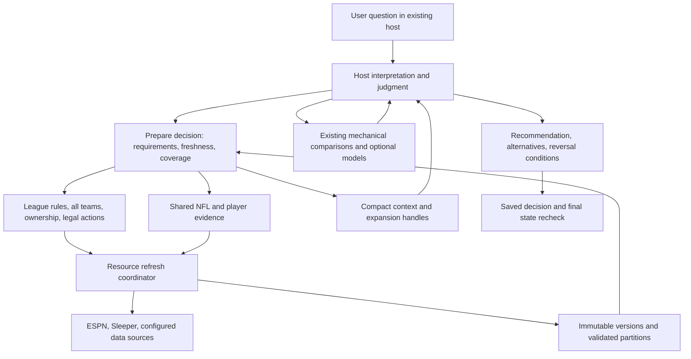

# Moneyball: a maintained fantasy decision workbench

Architecture decision and implementation plan · 2026-10-13

**Build one local evidence service that automatically prepares a fantasy decision for the agent already talking to the user.** Preserve Moneyball's existing league adapters, historical store, mechanical comparisons and assessment graph. Add coordinated acquisition, a compact decision context and reusable reasoning procedures. Keep experimental analysis available through explicit, inspectable contracts.

This document specifies the target architecture. Proposed interfaces, performance targets and experiments are **not implemented or measured merely because they appear here**. Existing capability claims refer to the inspected working tree, which contains uncommitted consolidation work. No claim of superior forecasts, championship outcomes or universal source coverage is established by this plan.

Implementation checkpoint, 2026-10-13: the decision lifecycle, bounded candidate search, consumed-evidence checks, persistent draft alternatives, capability-specific disclosures and opt-in maintenance are integrated through the local service and transports. Both regression suites pass (592 core, 389 connected tests). The installed wheel completed five CLI checks and 49 actual MCP SDK calls outside the checkout with synthetic evidence. One earlier native Claude waiver journey also used synthetic evidence; these receipts do not establish live recommendation quality, every host's automatic selection or draft latency. See [the agent journey](agent-strategy.md) for actual use and [reference transfers](architecture-references.md) for adopted mechanisms and rejected assumptions. Complete current-source coverage, calibrated future odds and draft latency targets remain separate, unproven obligations.

## 1. What the product must accomplish

The ordinary entry point is a question in Codex, Claude Code or another compatible host: “Find a trade,” “Should I accept this?”, “Plan my waivers,” “Who starts?”, “Who should I draft?”, or “Help me rebuild.” The user should not orchestrate data refreshes or populate a dossier manually. Routine preparation should normally require no additional research agents.

Success means the host receives sufficiently current rules, every team's relevant state, credible dated player evidence, legal alternatives and the uncertainties that could change the answer. The host makes and explains the judgment in the user's conversation. Moneyball preserves the evidence and calculations so another session can continue or challenge it.

The conversation establishes these distinctions:

| User intent or correction | Architectural consequence |
|---|---|
| Any fantasy question, not only named-player trades | A composable preparation interface plus focused evidence tools; no exhaustive intent classifier |
| One polished project | `moneyball.league` is the connected application; Art of the Deal remains a compatibility name, not another implementation |
| Fresh information immediately | Maintain shared evidence; refresh relevant resources on demand; disclose stale, failed and unconfigured sources separately |
| All teams matter | Keep a league-wide ownership and capacity index; screen alternatives across the field before narrowing |
| Different redraft, keeper and dynasty rules | Bind procedures to actual rules, retention costs and horizons; league labels alone are insufficient |
| Reuse strategy without blindly repeating it | Version a common mechanism library and league-specific applicability; revisit only affected assumptions |
| Numerical championship effects are the ideal | Build consequences toward that objective; use conditional scenarios and break-even statements until odds are defensible |
| Experimental breadth, build first and prune later | Retain promising sources and modules; distinguish exploratory use, reviewed reasoning and measured prediction |
| Better forecasts can be bought or borrowed | Prefer qualified professional inputs; build missing context, compatibility and decision accounting first |
| Injury risk, service, contracts and route share were examples | Cover the full causal path from ability and availability through allocation, scoring, lineup and competition |
| Smaller host models and compaction must work | Persistent decision context, compact defaults, explicit obligations and recoverable evidence |
| Draft advice must arrive within a minute | Precompute between picks, update actual board, offer alternatives, avoid live broad research |
| ADP helps timing, especially early | Treat it as a dated behavioral prior with uncertainty, never a value objective or guaranteed next board |
| No actions on the user's behalf | No trade, waiver, lineup, draft pick or message submission; local evidence writes remain allowed |
| Do not spend ages validating strategy before building | Independent framework review and a few complete walkthroughs now; rigorous data/mechanics checks; longer predictive evaluations only for claims that require them |

The requested “best pipeline” and “correct decision” are objectives, not evidence-backed comparative claims. The initial product promise is **well-informed, rule-correct, timely and explainable decisions**, with uncertainty exposed.

## 2. Foundation, implemented changes and remaining work

The current [architecture](architecture.md), [agent journey](agent-strategy.md), [pipeline documentation](data-pipelines.md) and [player workbench](player-assessment.md) remain the implementation baseline.

The following inventory records the planning baseline. The current checkpoint below supersedes its descriptions of missing operations; it does not erase the original reasons for choosing them.

| Area | Planning baseline to reuse | Operation identified at planning time |
|---|---|---|
| CLI/MCP | Canonical `moneyball`/`moneyball-mcp`; Art of the Deal forwarding modules | One preparation journey shared by transports |
| League adapters | ESPN and Sleeper normalization, exact IDs/rules/team selection | Independently versioned resources, capability flags and shared refresh coordination |
| Storage | Content-addressed raw data, append-only local versions, warehouse partitions, as-of reads | A decision manifest spanning both stores; finer dependency invalidation |
| Strategy | Rule profiles and host research bound to league, season, own team and method | Small reusable procedures with executable comparison obligations |
| Forecasts | Import validation and period/scoring/source cohorts; ESPN weekly baseline | Qualified professional feed scheduling and clear news/forecast readiness |
| Comparisons | Legal lineup assignment, trade/drop accounting, pickups and contingent claims | Broad candidate discovery and automatic evidence preparation |
| Assessments | Claim graph, provenance, dependency expiry, conditional future worlds | Separate reusable player claims from roster-sensitive decision bindings |
| Draft | Sleeper board identity/hash checks; conservative ESPN history support | Between-pick preparation, compact recovery and measured host deadline behavior |
| Analytics | Existing reliability, forecasting, horizon and simulation experiments | Explicit compatibility adapters; no automatic promotion to calibrated title odds |

At the initial audit, concurrent service instances did not share in-flight refreshes and Sleeper's acquisition pool was alphabetically bounded. Those two limitations have since been addressed: resource coordination uses SQLite leases and fenced publication, and Sleeper retains full unowned membership relative to the observed catalog/rosters before paging the display. Complete membership does not verify platform transaction eligibility. ESPN's bounded observed pool still cannot establish whole-pool optimality.

Remaining inspected limits: connected refresh still requests all 18 Sleeper matchup weeks by default, although noncurrent weeks use their independent cache policy. Bounded ESPN news discovery is integrated for recorded exact IDs, but leads are not verified reporting. Opt-in dated crosswalk assertions and target contradiction checks are integrated; unresolved and conflicting identities are quarantined; professional forecasts are not universally configured. Some evidence bindings conservatively include whole-roster or whole-collection changes. Do not narrow them until actual consumption supports a narrower dependency. Supplied future worlds do not comprehensively model adaptive future acquisitions, changing membership or calibrated player development.

Selected existing synthetic paths passed 35 targeted tests during this audit. That supports reuse of those paths; it does not demonstrate the proposed automatic product, live provider access or forecast quality.

### Current acceptance map

| Boundary | Authoritative implementation/check | What remains unproved or intentionally separate |
|---|---|---|
| Question to durable decision | `decision.py`; actual CLI/MCP lifecycle and one native host walkthrough | Automatic selection in every host and comprehensive live inputs |
| Resource identity, shared refresh and publication | `refresh.py`, `http.py`; lease replacement, failed refresh and strict draft request tests | Provider origin cache freshness; separate endpoints observing one instant |
| Evidence knowability and local consistency | `store.py`, `evidence.py`; cutoff, migration and publication-epoch tests | Retrospective files' historical publication dates without archive evidence |
| Complete action accounting | `trades.py`, `waivers.py`, `candidates.py`, `action_models.py`; hold, cut, both-team and retention fixtures | Counterparty consent, pending claims, unknown locks and unsupported keeper terms |
| Compact information with recovery | Original comparison/candidate expansion, consumed references and resume capsule | Retrieval relevance and semantic truth of host claims |
| Capability-specific readiness | `decision_readiness.py`; stale reporting, incomplete cohorts and blocked alternative recovery | No automatic recommendation approval, future valuation or title estimate |
| Optional analyses | `experiments.py`; supplied opportunity, role-world and weekly-competition inputs linked into manifests | Calibrated transitions, superior forecasts or multi-year championship odds |
| Between-pick draft preparation | `draft_preparation.py`; saved branch lookup, deadline, observed-board checks and invalidation through actual MCP calls | Whole-host sub-minute performance and late-round candidate quality |
| Maintenance and installation | `maintenance.py`; persisted jobs, installed-wheel CLI/MCP checks | No external scheduler installed; no hosted tenant isolation |

These are scoped acceptance statements, not a completion score. A useful partial decision and a fully qualified live decision are different product outcomes. The normal entry must disclose which one it produced.

## 3. Architectural choice

Use a **modular local application with durable evidence and a host-led decision workflow**. Two independent architecture candidates favored a thin preparation boundary over the existing operations; their agreement supports a design review, not empirical proof.



One process is sufficient initially. SQLite handles small records and coordination; the existing warehouse handles larger raw/clean/derived partitions. A manifest references both; do not merge them merely for aesthetic uniformity. Use ordinary Python, explicit schemas, SQL and existing HTTP clients. Do not add a graph database, universal agent framework, vector database, distributed scheduler or second model API by default.

Alternatives considered:

| Design | Benefit | Why not the initial choice; when to revisit |
|---|---|---|
| Many existing tools plus a longer skill | Almost no migration | Leaves small hosts to remember refresh, period, cuts, alternatives and provenance repeatedly; retain focused tools for escape paths |
| Autonomous recommendation endpoint | Fewer host calls | Moves judgment out of the user's session and duplicates strategy authority; consider only as an explicit future product mode |
| Event-driven microservices | Independent scaling | No demonstrated load justifies distributed state; revisit for actual multi-tenant throughput or independent failure domains |
| Document/RAG assistant | Easy prose search | Cannot enforce roster feasibility, forecast compatibility or historical availability; retain retrieval as one component |
| Simulator as the universal answer | Attractive single score | Missing inputs and future-management assumptions dominate; retain as a conditional analytical module |

### Ownership and implemented entry interfaces

`Service` stays the application facade. Provider modules own acquisition and normalization. `Store`/warehouse own immutable versions. `strategy.py` and `league_research.py` own policy binding. Existing lineup/trade/waiver/draft modules own their mechanics. `workbench.py` owns claim dependencies and scenario calculations. The integrated `decision.py` owns requirement selection, context assembly and decision lifecycle; `refresh.py` owns resource coordination. It must not duplicate domain calculations or become a second player database.

Implemented MCP entry names over the same local service; signatures below show the architectural shape, while `server.py` defines exact transport arguments:

```python
prepare_decision(spec: DecisionSpec) -> DecisionContext
decision_evidence(decision_id, focus, detail="decisive", cursor=None) -> EvidencePage
compare_actions(decision_id, actions, worlds=None) -> Comparison
record_decision(decision_id, host_judgment) -> DecisionReceipt
resume_decision(decision_id, refresh=True) -> DecisionDelta
```

These names are implemented; minimum domain shapes below remain design contracts, not claims that every field is available from every provider. Existing focused tools stay usable. `compare_actions` dispatches typed actions to existing owners rather than implementing their logic anew. `record_decision` validates references and required fields; it does not certify that an argument is true. A user can ask follow-ups or change the objective, producing a new revision rather than overwriting history.

Minimum domain shapes:

```text
LeagueRef: provider + league_id + season + own_team_id
DecisionSpec: question + league_refs + optional intent/focus + objective/horizon
              + deadline + optional historical_as_of + resource budget
ResourceVersion: source/resource/namespace + raw_hash + schema_version
                 + event_time + provider_published_at? + first_observed_at
                 + fetched_at + validity/revision + coverage + access_scope
Forecast: entity + target/units + season/period + source_origin/cohort
          + mean/distribution/threshold type + scoring scope
          + availability conditioning + missing components + evidence refs
DecisionContext: immutable manifest + exact rules + strategy ref + all-team index
                 + candidate coverage + focused evidence + actionable gaps
                 + readiness by operation + expansion handles + revision token
Action: Hold | Trade | AddDrop | OrderedClaims | Lineup | DraftPick | RosterPlan
Comparison: legal status + complete resulting state + displaced alternatives
            + conditional effects + assumptions + missing inputs + calculation refs
DecisionReceipt: chosen/alternative actions + argument/evidence links + confidence
                 + reversals + final recheck + host/model/version + outcome follow-up
```

Use typed boundary validation and explicit missing states: `unconfigured`, `unavailable`, `failed`, `stale`, `incompatible`, `partial`, `ready`. An empty successful response differs from a failed fetch. Readiness is per operation: unknown keeper cost can block a future keeper comparison while leaving this week's lineup discussion useful.

The implementation exposes overall `readiness` plus additive `capability_readiness`, not a universal numerical grade. Its capabilities are snapshot accounting, current-season weekly arithmetic, current decision evidence, future roster accounting, future valuation, platform execution and championship probability. Recognized typed gaps receive explicit affected scopes; unfamiliar codes and prose conservatively affect every capability. A complete actual calculator shape—not its status word alone—supports `available_conditional` arithmetic. A retention step can establish a conditional future roster without estimating its value. `unassessed`, `unverified` and `not_estimated` are not synonyms for approved. Keep the complete gap ledger and every alternative's disclosure in the receipt and resume capsule; uncertainty about a rejected branch may reverse the chosen branch.

### From an ordinary question to the service

Extend the existing packaged `moneyball-strategy` skill and MCP tool descriptions at the first increment. Its trigger covers fantasy decisions and research in connected leagues; the user need not know a tool name. The host recognizes the question, lists connected aliases when necessary, resolves a named league or an explicitly saved session league, and calls `prepare_decision`. If multiple leagues plausibly match, it asks one identity question while preparing shared player evidence. Never choose a league merely because it was most recently refreshed. With no connection, use the onboarding flow in §5 and return an honest setup state.

The skill supplies the small decision contract and expansion rules, not an entire strategy book on every call. Subsequent questions reuse the decision ID and call `resume_decision`; compaction recovery loads the capsule before consulting the user's saved league preference. A change of league, horizon or rules creates a new binding. Focused current tools remain a fallback during migration. Installation registers the local stdio MCP and skill for supported local hosts; host-controlled skill/tool selection is not guaranteed interception of every prompt. Prove this entry path in an actual supported host with an ordinary question, and document explicit skill invocation when a host does not auto-select it.

## 4. References with specific jobs

The following architecture mechanisms were inspected in source or primary documentation. They are **references**, not dependencies to install wholesale. Pinned revisions make the transfer auditable; licenses apply to code, not automatically to upstream data.

| Reference | Transfer into Moneyball | Caveat and acceptance check |
|---|---|---|
| [OpenBB fetcher](https://github.com/OpenBB-finance/OpenBB/blob/7c9d4221bdf66965e3f6c7f4dc6ee848073e5ae2/openbb_platform/core/openbb_core/provider/abstract/fetcher.py), [result envelope](https://github.com/OpenBB-finance/OpenBB/blob/7c9d4221bdf66965e3f6c7f4dc6ee848073e5ae2/openbb_platform/core/openbb_core/app/model/obbject.py), Apache-2.0 | Query/extract/normalize contract with provider, warnings and extras; add source adapters without rewriting decisions | Same schema does not mean same conditioning. Active-only and unconditional forecasts must remain distinguishable |
| [Home Assistant coordinator](https://github.com/home-assistant/core/blob/8c014f3e4ce2d987a94d16db9e0d7c19dda89b00/homeassistant/helpers/update_coordinator.py), Apache-2.0 | Resource-level refresh coalescing, success/error separation and change notification | Current-state caching does not supply history. Concurrent requests share work; failed refresh preserves old evidence dates |
| [Cube compiler](https://github.com/cube-js/cube/blob/0b90fd303d44e11cd431100680ab2e7e20997ff2/packages/cubejs-server-core/src/core/CompilerApi.ts), Apache-2.0 with package exceptions | Versioned metric definitions and dependency-sensitive query keys | Metric definition is not predictive merit. Denominator and rule changes must alter compatible queries |
| [HL7 CDS Hooks 2.0](https://cds-hooks.hl7.org/2.0/), [pinned source](https://github.com/cds-hooks/docs/blob/765cda431b789487d62ebe7f66122691dd3d8623/docs/specification/current.md), Apache-2.0 | Task-bound prefetch requirements, attributed alternatives and replacing stale advice | Borrow workflow, not clinical authority. Missing data must not turn into reassuring absence |
| [StatMuse fantasy manager skill](https://github.com/statmuse/fantasy-football-manager/blob/bd55f95b04ed2476d84bf2942191ad3c227e03af/SKILL.md), Apache-2.0 | Deduplicate shared player evidence across leagues, then specialize each decision | Do not inherit its fantasy heuristics. Same player can have different value under different rules |
| [Sleeper MCP storage](https://github.com/vbudhram/sleeper-mcp/blob/5bc255961afc62174e75cba2f213f3e9243f5382/src/sleeper_mcp/storage.py), MIT | Resource TTLs, snapshots and compact changes | Deduplicated first/last-seen history is not every transition; test deletion and A→B→A history |
| [ESPN MCP client](https://github.com/heyitaki/espn-fantasy-football-mcp/blob/327d58c41dfcb8cc8ddefcf62fb39674cb43ebff/src/espn/client.ts), MIT | Simple typed provider access; keep transport modest | Its professional-team promise is cached; league fetch behavior differs. Do not generalize cache absence from shallow search |
| [ffscrapr Sleeper](https://github.com/ffverse/ffscrapr/blob/b6990181e125507a1b4642cea6bc9778d9acd6f3/R/sleeper_rosters.R), [ESPN](https://github.com/ffverse/ffscrapr/blob/b6990181e125507a1b4642cea6bc9778d9acd6f3/R/espn_rosters.R), MIT | Equivalent league operations retaining platform extras; provider-fixture reference | Current adapters remain owners; preserve eligibility differences and not-yet-drafted states |
| [ffsimulator projection components](https://github.com/ffverse/ffsimulator/blob/9d8bc79354ed79bd9f9ac028c3f3442b271afea5/R/4_projections.R), MIT | Separability of simulation components and a baseline challenger | Repeated seasons are draws, not dynasty development; rank conditioning and independence need explicit labeling |
| [Sports Hub tool pipeline](https://github.com/lacausecrypto/mcp-sports-hub/blob/95d6046c80d33f101b4f496c343510265e64ab4c/src/shared/tool-pipeline.ts), MIT | Shared response shaping and selective provider registration as a retained challenger | Inspected package, registry, HTTP, projection and test source; not run upstream. Arbitrary key selection or shortened arrays can lose decisive caveats. Preserve mandatory qualifiers and full expansion originals |

Follow-up source inspection deepened the refresh and recovery decision through three connected layers: observed refresh/publication failures → TanStack and DBOS ordering/fencing mechanisms → DVC dependency/cache semantics and SQLite isolation. [The transfer report](architecture-references.md) records pinned sources, changes, exclusions and discriminating checks. The local implementation uses a narrow coordinator and immutable input manifests rather than installing those frameworks. A current default, upstream issue report, inspected test and locally reproduced behavior are separate evidence categories; an upstream issue alone is not a confirmed defect here.

For implementation speed, adapt mechanisms already present before importing code. Copy licensed code only when it removes a concrete maintenance burden, retain attribution and inspect its dependencies. Unlicensed or proprietary repositories may inform questions and independently implemented ideas; do not bundle their code.

## 5. Acquisition and data lifecycle

### Onboarding and platform capabilities

Sleeper: discover public leagues through the existing adapter, confirm season and own team, retain co-ownership and traded picks. ESPN: use exact league URL/ID and season with public access or explicitly configured private credentials; account-wide discovery and OAuth are not assumed. January must not silently select the wrong football season. If identity is ambiguous, ask once rather than guessing.

Normalize rules, rosters, schedule/standings, transactions, acquisition rules/pool and draft state as separate resources with compatibility checks. Retain provider-specific fields and `unknown` capabilities. CBS/Yahoo/other platforms later implement this contract; until then, an explicit import can provide evidence but must not masquerade as a live connector. Lock state and waiver status must be verified or marked unknown.

### First usable evidence paths

These are the selected initial paths, with implemented and proposed parts distinguished. No paid account or working entitlement is assumed.

| Resource | ESPN first path | Sleeper first path | Readiness and fallback |
|---|---|---|---|
| Rules, teams, ownership, schedule | Existing ESPN adapter and configured public/private access | Existing public Sleeper adapter | Verify season, own team, completeness and separate resource dates; keep prior success after failure |
| Acquisition pool | Existing ESPN free-agent operation, with explicit filters/page coverage | Implemented full current catalog/ownership index before screening; alphabetic ordering applies only to paged display | Catalog membership and current transaction eligibility are separate from forecast coverage. Unknown locks or incomplete enumeration stay visible; a bounded shortlist cannot claim whole-pool optimality |
| Weekly forecasts | Existing native ESPN baseline, labeled as such; qualified independent import alongside it | Explicit compatible forecast import until a qualified feed is configured | Correct period, scoring components, player crosswalk and availability conditioning are mandatory. Missing forecasts are not zero. The host can give a conditional comparison when coverage is incomplete |
| Optional professional forecast acquisition | Both platforms use the existing FFToday-through-Firecrawl adapter after credential, terms and explicit credit-budget setup | Same shared NFL feed, rescore independently for each league | Adapter code exists; live execution was not verified in this architecture audit. Only qualified weekly component rows enter arithmetic; other provider artifacts remain evidence until mapped |
| News and availability | Dated official NFL/team reports obtained through focused host research initially | Same shared source/claim records | [Official NFL injury reports](https://www.nfl.com/injuries/) are a concrete initial status source. Save original attribution, event/publication/observation dates and a permitted summary. Focused live preparation now adds bounded ESPN discovery leads where exact IDs exist; originals and claims still require host verification. This is not a universal verified news feed |
| Player identity | ESPN namespace plus dated, qualified identity assertions | Sleeper namespace plus dated, qualified identity assertions | Preserve unresolved identities; require provider IDs or inspected exact disambiguation. Never join automatically by a fuzzy name |

The optional forecast route is documented in [the existing feed adapter](firecrawl-feed.md) and [Firecrawl's FFToday capability](https://www.firecrawl.dev/alexandria/fftoday-com). Discovery supplies the current tool contract and price; do not guess fields, auto-accept terms or automatically retry a paid request whose result is unknown. Keep FFToday as forecast origin and Firecrawl as delivery gateway. Provider observation time does not prove forecast issue time. Test candidate/free-agent coverage as well as owned players.

For automated news beyond host-assisted fallback, qualify one maintained discovery adapter first: [Exa](https://exa.ai/docs/reference/search) **or** [Tavily](https://docs.tavily.com/documentation/api-reference/endpoint/search), restricted to the primary sources relevant to owned/candidate players and teams. Their documented search interfaces are leads, not proof of complete coverage or a working configured feed. Inspect originals; a snippet is not a verified injury record. Prefer an entitled structured feed if it supplies material missing fields: [SportsDataIO's NFL schema](https://sportsdata.io/developers/data-dictionary/nfl) is a paid candidate to inspect, including actual coverage, timestamps and redistribution rights. Do not use scrambled trial data for advice. Choose between these paths using a small set of real decision-relevant records; do not integrate every vendor first. [The source/tooling dossier](data-tooling-october-2026.md) preserves the researched alternatives.

An installation without a qualified forecast or news feed must still prepare league mechanics and identify gaps, then let the host perform focused research or ask for an import. It must not advertise unattended, comprehensive fresh-data preparation. A complete journey is an operation-specific readiness result, never inferred from a successful login.

### Refresh once, serve many questions

Key refresh work by provider, credentials/access scope, resource, parameters and parser version. Coalesce concurrent requests; enforce shared rate limits, bounded retries, jitter and `Retry-After`. Keep an attempt record separate from the last successful version. Use process/SQLite coordination first, including leases that expire after a crashed worker. A revision should publish only after its required components validate; independent partial resources can remain available with explicit coverage.

Use conditional requests, content hashes and incremental cursors where the provider supports them. Replay an overlap window for corrected data, deduplicate by stable record key and revision, then publish a new immutable partition. Persist checkpoints only after successful publication. A no-change fetch records a new check receipt without pretending the content was newly authored. A source disappearing or deleting a field is a change too.

Maintain resource-specific freshness policies based on publication cadence and decision deadlines, not one universal TTL. Rules need a cheap check near decisions; ownership, locks and draft boards require stronger checks before final advice; weekly projections need the correct week and update state; historical bulk partitions can be reused until revised. Ordinary explicit refresh bypasses age preference while joining in-flight work and respecting limits. Fresh draft reads additionally require a local request started after the caller began its check; an older joined response cannot satisfy that strict mode. This does not guarantee provider cache freshness. A historical `as_of` query must not fetch present data into its past feature set.

Scheduled maintenance and on-demand preparation call the same jobs. A sleeping laptop catches up when queried; advice cannot depend on a daemon having run. Create an app automation only when recurring operation is enabled, using the supported automation mechanism. Report material actionable changes or failures; avoid repetitive unchanged alerts. Optional push/webhook feeds are adapters, not assumed platform features.

Treat fetched articles, tool responses and extracted claims as untrusted evidence, never as instructions to the host. Keep credentials in local secret storage and out of source captures, error traces and exports. Respect each source's capture/redistribution rights; retain a locator and permitted excerpt when storing the whole source is disallowed. Local installation uses existing authorized provider setup, not automatic imports from a personal browser profile.

### Three layers and historical knowability

1. **Raw:** immutable provider bytes or permitted source capture, sanitized metadata, content hash and access receipt.
2. **Clean:** typed provider records, identity crosswalks, units, period, source origin, schema version and explicit missingness.
3. **Derived:** metric/model outputs with input version IDs, code/definition version, assumptions and reproducible query.

Store event time, provider-claimed publication time, locally first observed time and retrieval time separately. Track revision validity as well as repeated observation. Default local historical queries require evidence observed by the decision cutoff. Separately verified archives can support an explicitly labeled archival-knowability policy; never backdate local collection because a file says “2024.” Feature manifests and later outcomes use distinct roles in evaluation. Current rosters cannot silently define the historical survivor population.

Validation at ingest: schema/units/enums; key uniqueness; range and missingness checks; row-count deltas relative to the same scope; stat reconciliation where a second source exists; source-specific denominator identities. Quarantine suspect partitions, retain previous success, and show the reason. Zero rows may be legitimate in an offseason resource; validity is resource-specific. No “missing interception line = zero interceptions.”

### Source portfolio and semantic contracts

Source registry fields: origin, access method, credentials/rights, acquisition status, cadence, history, versioning/knowability, ID mapping, coverage, target and conditioning, upstream dependencies, known defects, cost, last successful fetch and failure. Keep **access, relevance, independence and demonstrated accuracy separate**.

| Evidence family | Initial path and intended use | Critical limits |
|---|---|---|
| All league state | Existing ESPN/Sleeper adapters | Fresh roster does not imply fresh news/forecasts; pool completeness needs its own flag |
| Play-by-play, participation, snaps, rosters and schedules | Existing nflverse/warehouse integrations; map exact dataset/version | Historical revisions, missing routes and ID gaps; never promise universal tracking |
| Opportunity quality / xFP | Existing sample-consuming dossier code plus [ffopportunity](https://github.com/ffverse/ffopportunity) as the acquisition/model reference; no maintained live pipeline yet | Expected value of observed opportunities is retrospective; forecast future volume separately and rescore for actual rules; inspect GPLv3 code and CC BY-SA model/data obligations before reuse |
| Weekly/season professional forecasts | Current validated imports; qualify configured feeds behind common forecast contract | ESPN is a visible baseline, not the authority. No vendor is declared best without relevant dated evidence |
| News, availability and practice | Configured official/licensed feeds and targeted primary reporting; archive assertions and original attribution | Failure is not “no news”; reports can be copied or conflicting; return to play differs from full role |
| Contracts, coaching, depth and personnel | [rotc](https://github.com/nflverse/rotc) as a contract acquisition reference; dated official/source records | Expiry is not departure, vacancy is not inherited usage; nominal depth chart is not deployment certainty |
| Scouting, college/draft/athletic data | Retained prospect sources and [nfl_combine](https://github.com/tanho63/nfl_combine) discovery | Selection, age and competition-level effects; keep measurements and judgments separate |
| Props, totals, fantasy-point lines and prediction markets | Configured licensed snapshots or explicit permitted imports | A threshold is not a mean; vig, settlement, liquidity, horizon, copied lines and suspended markets matter |
| ADP, rankings, trade values | Platform-visible snapshots and permitted provider histories | Behavioral reference/alternative baseline, not universal truth or direct championship value |
| Route, separation, pressure, scheme and tracking grades | Licensed feeds where available; BDB research modules where scope fits | Paid access may be load-bearing; competition samples are not current-season coverage |

Retain paid sources with purchase/access requirements and what uncertainty they could resolve; do not discard them as low quality merely because unavailable. This plan does not claim that a calibrated public injury-risk winner, broad multi-year player odds, or every desired route statistic has been found. Such claims require source-specific audits.

Missing components have an explicit hierarchy: compatible same-period expert estimate; transparent conditional model from appropriate primitives; a labeled sensitivity range; otherwise incomplete. For interceptions, for example, separate projected pass attempts from a shrunk conditional interception rate, preserve uncertainty and reconcile with the rest of the provider's projection. Do not silently mix incompatible sources or add a contextual adjustment already priced into the baseline.

More books or analysts do not automatically mean more independent observations. Group common origins, compare residual information where dated outcomes exist, preserve disagreement, and report the number of source families rather than treating every repost as new evidence. Team futures can constrain a scenario about team environment; they do not identify which individual receives the work.

## 6. Compact evidence without removing nuance

Keep structured tables and source documents outside the prompt. Query by player/team, period, metric and source before formatting. Extend the current bounded pipeline bridge with deterministic ordering, explicit `as_of`, stable pagination and coverage; “first rows returned” is not “latest evidence.” Maintain a crosswalk coverage map; name similarity is not an automatic join. Coverage is evaluated for the exact players needed by the question: cached provider assertions, live target qualification and verified reporting are separate states. Unresolved, ambiguous or contradictory assertions quarantine the affected branch; never assume the whole catalog is qualified from three successful targets. Preserve the last dated binding, allow an inspected exact-ID import, and expose the gap when no safe binding exists. Source or binding changes invalidate consumed decisions. During a pick, use cached qualified targets or conditional alternatives rather than start a bulk identity acquisition. The native three-target run demonstrates this path; full-catalog coverage remains unmeasured.

A small metric registry owns formula/version, numerator, denominator, population, units, time window, missingness and dependencies. Share definitions across queries. Preserve provider-specific metrics when definitions differ. Use the existing assessment graph for observations, interpretations, assumptions, forecasts and their supporting/contradicting claims. Add reusable player-level bindings; attach roster/rules/ownership dependencies only to decision-specific effects.

Three retrieval levels:

1. **Default decision card:** objective/horizon, key rules, current state, ranked alternatives, decisive evidence and counterevidence, missingness, reversal conditions, freshness and handles.
2. **Focused expansion:** relevant trends, distributions, source disagreement, causal dependencies, surrounding quotation/table headers and calculation inputs.
3. **Raw audit:** original capture or permitted link/locator, full definition, input versions and extraction receipts.

Default cards must not claim exhaustive coverage. Return the candidate universe and exclusion reasons, not just selected winners. An unexpected player or mixed question can expand beyond the shortlist. Retain discarded hypotheses and their revisit conditions without putting them all into every prompt.

Implementation references: use [SQLite FTS5](https://sqlite.org/fts5.html) as the first text index; retain hit and parent-section locators separately. Adapt parent/context-window retrieval from LangChain/LlamaIndex without installing the frameworks. Optional [Trafilatura](https://github.com/adbar/trafilatura) can extract recurring HTML; test negation, attribution and qualifier retention. Optional [LangExtract data model](https://github.com/google/langextract/blob/f6dc772b738a44cd6f77d0858d6ce3afa16acd15/langextract/core/data.py) and [resolver](https://github.com/google/langextract/blob/f6dc772b738a44cd6f77d0858d6ce3afa16acd15/langextract/resolver.py) preserve spans and exact/fuzzy alignment; matching a span does not prove entailment. Docling is a difficult-document option, not a default: inspected budget paths can discard headings/captions. Keep embeddings, reranking and LLMLingua as challengers for measured retrieval/compression failures, after removing repeated boilerplate.

Save a compact **decision capsule**: question, league/team/rules/method IDs, objective, current manifest, considered alternatives, decisive claims, unresolved reversals, next useful operation and deadline. On resume, fetch the capsule plus material changes; do not replay the whole chat or trust a lossy transcript summary as league state. A roster delta may invalidate a trade result without invalidating the player's underlying evidence.

## 7. Strategy: reusable reasoning that reaches the actual choice

Use three composable procedures. Their fit is strong at the level of decision structure; empirical input quality and achieved advantage remain separate uncertainties. They are not rigid prompts that force every question through every step.

### A. Complete counterfactual comparison

Used for trades, waivers, lineups and draft alternatives. Compare **action plus subsequent feasible management** against **hold/alternative plus subsequent feasible management**. Include the players displaced from starts, required drops, lost flexibility, acquisition costs, eligibility and both teams when trading. A sum of player values cannot substitute for resulting roster function.

Use the same information timing, budget discipline and future decision policy across branches, with branch-specific attainable actions. A trade or spent FAAB legitimately changes later options; an invented favorable follow-up in only one branch does not. Record counterpart consent and contested claims as uncertain execution conditions. Do not force identical future moves, and do not assume every desired future transaction clears. If the continuation already models a flexibility benefit or loss, do not count a generic flexibility bonus or penalty again; disclose any unmodeled consequence separately.

The host states the objective, generates legal alternatives, uses Moneyball's mechanical results, identifies the decisive uncertain input and explains the recommendation. The service enforces checkable obligations: exact identity, complete after-roster, comparable period/scoring, explicit missingness, hold and affected constraints. It checks presence and references, not semantic wisdom.

### B. Conditional futures and flexibility

Used whenever retention, role changes, availability or future actions matter. Preserve a small set of distinct worlds and year-specific consequences. Compare dominance, tradeoffs and the condition at which a ranking reverses. Do not invent scenario probabilities or an age penalty to make one scalar convenient. Expose current contribution, future paths, capacity cost, downside recoverability and available follow-up actions separately.

When unweighted worlds give crossing outcomes, the answer contract permits a conditional choice or frontier, not an unconditional numerical winner. Ranking requires a dominance result, an explicit user preference or supported probabilities. Candidate coverage is part of that contract: identify the searched universe, omitted alternatives and whether an unseen free agent, draft candidate or rival offer could reverse the choice.

A successor prospect's path is conditional: incumbent leaves → organization does not replace externally → prospect wins a role → role produces valuable opportunities → production enters our lineup → our team reaches and wins the relevant contests. Research only the links that can change the present decision. Several attractive stories sharing the same assumption are not diversified bets.

### C. Decision-directed investigation

Used when a gap or contradiction could reverse the answer. Specify the missing proposition, affected alternatives, evidence that would discriminate and deadline. Search existing local evidence first, then configured sources, then primary research/OSS/expert evidence. Stop when alternatives are robust enough for the task, further accessible evidence is unlikely to distinguish them, or the deadline requires a conditional answer. Do not calculate numerical value of information without support for its probabilities.

Escalate to a subagent only for a genuinely independent consequential question; routine ingestion, arithmetic and lookup stay in code. Reopen broad `strategize-deeply` research for a new rule mechanism, a persistent failure or an objective change. Most asks reuse the current procedure. RDD/it-already-exists finds methods when a needed operation is missing; it is not a mandatory literature review for every waiver claim.

The saved host judgment includes action IDs from an actual comparison, referenced claims, a strongest countercase and any qualitative override. The service checks that cited branches and evidence exist and that the latest recheck still applies. Unmet requirements produce a partial/conditional status, not a silently certified recommendation. A pure research question may end with an assessment; it need not fabricate a transaction to satisfy the contract.

### Rule adaptation and evidence hierarchy

The strategy binding includes full scoring, eligible slots, bench/IR/taxi capacity, retention/keeper prices, acquisition rules, schedule/playoffs, deadlines, own team, season and method version. The host's objective is separate: win now, multi-year contention or a chosen rebuild horizon. If time preferences are unspecified, show a frontier instead of silently choosing a discount rate.

| Mode | Change to the comparison |
|---|---|
| Redraft | Remaining scoring periods, playoff path, replaceability and deadlines; no player retention payoff after season |
| Keeper | Exact eligible keepers, cost/round escalation, limits, expiry and displaced keeper; uncertainty blocks only affected future arithmetic |
| Dynasty | Future service, picks, roster capacity and tradeability under explicit assumptions; no automatic “young is cheap” rule |
| Unusual scoring/format | Recompile metric/scoring and action constraints; missing bonuses, best-ball or nonlinear rules cannot be approximated silently |

Evidence hierarchy is target-dependent: exact rules and ownership govern mechanics; compatible professional forecasts are central baselines; observed process data contextualizes changes; dated credible reports update assumptions; consensus informs cost/behavior; unsupported narratives remain hypotheses. Several correlated metrics do not become independent votes for talent. Source confidence, model confidence and recommendation robustness are different fields.

Framework vetting before build: one independent reviewer receives objective/rules/evidence without a favored answer; another challenges causal assumptions, omitted alternatives and future-management symmetry. Resolve substantive disagreement against source or a small discriminating calculation. Walk through a trade, a contingent waiver plan and a dynasty draft/rebuild decision. One revision/review round is the default; extend only for a material unresolved flaw. Agreement is not predictive validation.

## 8. Forecast the entire path, not one attractive statistic

The following is the required information map, not a requirement to fit every model before launch.

| What must be estimated | Short horizon | Longer horizon / causes of change | How it reaches a decision |
|---|---|---|---|
| Availability and capacity | Active probability, limitation, return workload | Recurrence/absence duration, post-return recovery; medical/context evidence | Missing starts, reserve pressure, correlated exposure and replacements |
| Ability by task | Context-adjusted execution, uncertainty in sparse work | Development/decline by skill and role; age is one covariate | Conditional efficiency and chance of retaining/winning work |
| Deployment | Participation, routes, carries, alignment and situations | Staff/system, personnel, contracts, competition and adaptation | Distribution of valuable opportunities, not a route-share score by itself |
| Team opportunity environment | Plays, dropbacks, rushes, scoring chances, game state | QB, line, coaches, roster quality, tendencies and schedule | Top-down consistency and opportunity quality |
| Conversion and scoring | Yards, catches, TDs, turnovers and other configured events | Stable skill versus transient realization and regime changes | Exact league-scored distribution with missing components visible |
| Dependence | Teammate competition, game/weather environment, shared absences | Common roster/team transitions | Team tails and risk concentration; cannot assume independent player draws |
| Acquisition and replacement | Actual pool, claim constraints, deadlines, board | Rookie inflows, retention, competition, trade friction | Feasible recovery and opportunity costs for every action |
| Competition | All-team legal lineups, schedule and standings | Changing opponent holdings and policy scenarios | Qualification, bracket and title consequences |
| Market/execution | Current public reference points and observable team needs | Holding costs, contingent demand and future liquidity | Attainable offers and waiting costs, not imaginary resale value |
| Objective and policy | Which decision is controllable now | Future observation/action opportunities and user's horizon | Fair branch comparison and explicit tradeoffs |

Velocity/acceleration can be descriptive features of smoothed latent role or ability, with exposure and uncertainty. Differencing noisy raw weekly fantasy points amplifies noise. Retain raw series, change indicators and causal context; do not label a short positive slope “breakout” without considering role, opponents, injuries and sample selection.

An injury percentage is useful only with a defined event, horizon, eligible population and calibration. A forecast of “miss any game this season” is not a forecast of next-week unavailability or diminished workload. No injury source is granted a universal best label in this plan. Assess evidence at its actual target and keep paid candidates visible.

## 9. Automatic loops and complete user journeys

The common loop is **prepare → compare → investigate material gaps → revise → recheck → explain/save**. Code handles refresh, identity, schema, constraints and calculations. The host handles interpretation and conclusions. Stop conditions and failure states are part of each loop.

### Representative first slice: Tuesday waiver question

1. Resolve the connected league, own team, objective and current evaluation week.
2. Prepare exact rules, every roster, complete or explicitly bounded acquisition universe, priority/FAAB and deadlines. Read the saved strategy; create a host research task only for a missing relevant mechanism.
3. Reuse shared player data and refresh matching-week forecasts/news where configured. Expose missing feed/crosswalk coverage immediately.
4. Generate a broad candidate set from legal eligibility, current contribution, future paths and event-driven role changes. Do not take alphabetically first free agents or permanently prune to top projected points.
5. Compare hold and complete add/drop packages, then ordered fallback claims. Successful earlier claims alter capacity, budget and priority for later claims.
6. Consider other teams' needs as scenarios about competition. Unknown pending claims remain unknown; no invented exact acceptance/capture probability.
7. Investigate only uncertainties that could change claim order, price or drop. Recheck pool/ownership/deadlines, explain choices and save the receipt. User submits claims.

This is the target first integrated journey, not a reduction of the complete scope. Stage 1 demonstrates the entire path with synthetic complete evidence and a real partial-answer path using current capabilities. A real complete recommendation requires the pool, identity, forecast and news readiness gates below; missing evidence is not waived to declare the slice complete.

### Other journeys through the same contracts

| Ask | Candidate generation and comparison | Final answer must preserve |
|---|---|---|
| “Should I accept this trade?” | Resolve every asset; legal after-rosters for both teams; necessary cuts; hold and reachable waiver/replacement alternatives; future retention if relevant | Why our lineup/future options improve, counterpart's functional benefit, price/rarity, risk and reversal |
| “Find trades for me” | Scan all-team surplus/deficit/capacity; enumerate bounded simple swaps/packages; retain complementary and future-facing candidates; deeply evaluate finalists | Benefits for both, feasibility, evidence-supported negotiation rationale; acceptance remains unknown |
| “Who starts?” | Exact eligibility and verified locks; matching-week conditioned forecasts; opponent state if available; compare complete lineups | Mean-versus-upset tradeoff where justified; uncertainty in variance/dependence; no blanket “trailing means maximize variance” rule |
| “Who should I draft?” | Current board and roster; candidate frontier across positions/horizons; timing cost from rough ADP plus observed deviations | First choice plus meaningful alternatives, immediate value, future conditions and risk of waiting |
| “Rebuild for next year” | Hold/sell/acquire packages; future capacity, picks, contracts, role states and plausible buyers; equal management assumptions | Multi-year frontier, acquisition prices, shared failure modes and what to monitor; no assumed liquidation at chart prices |
| “Research this player” | Start with the question's target/horizon; evidence facets and contradictions; compare relevant peers/alternatives | Ability/work distinction, source dependencies, conditions and missing evidence |
| “What changed?” | Resume saved capsule and dependency-aware delta | Which evidence changed, which conclusion changed, which prior evidence remains useful |
| Mixed/unanticipated question | Common identity/rules/freshness context, host-composed evidence needs, focused tools | Scope limitations without forcing a wrong template or failing the whole request |

### Live draft path

Prepare strategy, roster constraints, player evidence and a broad option frontier before the draft. Between picks, update the board, current team and field; cache comparisons of plausible candidates. Use ADP as an uncertain timing signal, with weaker reliance as observed behavior diverges and later rounds widen. Never assume a fixed list of future reasoning moments.

On the clock: fetch current board/revision → remove unavailable candidates → recompute legal marginal effects → retrieve decisive cards → host gives a ranked choice and alternatives → final board recheck. If the target disappears, cached alternatives remain ready. A novel candidate gets focused evidence; a partial conditional answer is preferable to exceeding the clock while pretending completeness. The product never pauses the room, enables autopick or selects a player.

Proposed target: warm preparation p95 ≤2 seconds on declared hardware; on-clock observation-to-usable-recommendation p95 ≤45 seconds, leaving a buffer under the user's minute. These are design targets, not measured promises. Track cold/failed runs separately. After a user pick, emit the next rough slate first, then deeper roster critique between turns. On compaction, restore the capsule and current board before reasoning.

Use an absolute deadline, not a fresh timeout for each tool. Default cumulative budget from the observed start of our turn, shortened when less clock remains:

| Elapsed deadline | Work | Timeout/fallback |
|---|---|---|
| 0–4 seconds | Read current board/roster revision and capsule | One bounded read; use the last verified board only with its age and an explicit availability condition. No repeated slow refresh |
| By 8 seconds | Recompute legal shortlist and retrieve decisive cached cards; join already-running refresh only within budget | Local mechanics proceed; slow optional sources are marked stale/unavailable and cannot block |
| By 25 seconds | Host emits first useful choice and cross-position alternatives from prepared comparisons | If new reasoning cannot finish, surface an already-authored, still-valid branch with its conditions; otherwise a clearly provisional shortlist and the decisive gap |
| By 35 seconds | Recheck board and amend only affected alternatives | A snipe promotes a valid cached alternative; unfamiliar candidates get a conditional assessment, not a broad research run |
| By 45 seconds | Final concise recommendation/conditional alternatives delivered | Stop research on clock; leave remaining time for the user's action |

Between-pick preparation must pre-author short recommendation branches, not merely save numbers that still need a long synthesis. A host cannot guarantee its own generation finishes by a deadline: measure actual model/host runs, keep first-answer length bounded, and expose a cached branch through a cheap tool response if fresh reasoning stalls. Cold starts load minimal rules/roster and an existing capsule first; absent those, state that preparation is incomplete and offer only supported conditional options. Source-failure runs return the last verified evidence with its limitations. Never give a stale-board recommendation as if availability were confirmed. This is an acceptance specification, not a claim of an installed deadline controller.

## 10. Experimental workbench and OSS composition

Retain the existing [reference catalog](../moneyball/league/data/workbench-references.json). It records 34 sports and adjacent-domain leads with transfer limits. “Retained” does not mean installed, licensed for all uses or validated. Implement coherent families against one module contract rather than merging entire repositories.

```text
AnalysisModule:
  question/decision served; supported rules and horizons
  required datasets, grain, rights and as-of policy
  output schema, units, conditioning and dependencies
  source/code/model versions; assumptions; missingness behavior
  baseline; trust status; known failures; cost; revisit trigger
```

Useful families and exact jobs:

| Family and references | Build/use | What must not transfer |
|---|---|---|
| [ffopportunity](https://github.com/ffverse/ffopportunity), [ml-oddbox-forecasting](https://github.com/edward-sims/ml-oddbox-forecasting) | Observed opportunity value; team total × allocation share; reconcile top-down and bottom-up forecasts | Current-outcome features or published validation numbers; xFP as an unconditional future forecast |
| [LaMa](https://github.com/janolefi/LaMa), [LatentMarkov](https://github.com/janolefi/LatentMarkov) | Role states, persistence and duration; expand existing supplied-transition calculator when needed | Fitted NFL transitions or calibrated hidden states that have not been estimated |
| [ratings-are-not-forecasts](https://github.com/ghadfield32/ratings-are-not-forecasts) | Separate ability rating from future participation/deployment | NBA performance claims as NFL validation |
| [nfl-draft-analytics](https://github.com/emmett-hannam/nfl-draft-analytics), [draft outcomes SQL](https://github.com/mklim6/nfl-draft-outcomes-sql) | Cohort priors, failures and follow-up exposure; independently implement shrinkage concepts | Survivor-only samples or guessed optimal prior strength; first repo had no inspected license |
| [rotc](https://github.com/nflverse/rotc), [ffhistorian](https://github.com/ffverse/ffhistorian) | Contract facts and dated market/league observations | Guaranteed departures or retrospectively invented historical availability |
| [nflseedR](https://github.com/nflverse/nflseedR), [ffsimulator](https://github.com/ffverse/ffsimulator) | Separate competition rules from outcome models; compare simple simulation baselines | NFL standings logic as fantasy rules; simulation repetitions as evolving years |
| [RouteIdentification](https://github.com/danichusfu/RouteIdentification), [PreSnapPrediction](https://github.com/MLecardonnel/PreSnapPrediction), [HMMotion](https://github.com/janolefi/HMMotion) | Route/assignment/context representations and scheme questions | Selected tracking labels as identified talent; GPL code bundled without license review; unlicensed code copied |
| [ExpectedTackling](https://github.com/MLecardonnel/ExpectedTackling), [PEP](https://github.com/janolefi/PEP) | Correct opportunity denominators and with/without-player questions | Random tracking frames as independent future games; feature interventions as established causal effects |
| [conditional yard distribution](https://github.com/edward-sims/nfl-big-data-bowl), [separation study](https://github.com/ghadfield32/nfl_big_data_bowl_2025) | Distribution outputs, grouped evaluation and context-sensitive receiving analysis | Target/post-snap selection or questionable ratios as ready pregame forecasts |
| [coaching decision lab](https://github.com/mklim6/nfl-coaching-decision-lab), [QB archetypes](https://github.com/mklim6/nfl-qb-archetype-clustering) | Staff/personnel/game-state covariates; descriptive profiles | Leaky splits or resemblance as a success probability |
| [context-is-not-information](https://github.com/ghadfield32/context-is-not-information), [when-state-becomes-information](https://github.com/ghadfield32/when-state-becomes-information) | Ask whether new context adds information; hold out people/regimes where appropriate | Missing replication data, tiny other-sport samples or related sibling papers as independent confirmation |
| [Big Data Bowl](https://github.com/nfl-football-ops/Big-Data-Bowl), [open-source-football](https://github.com/nflverse/open-source-football) | Seed discovery → author profiles → sibling repos → primary methods and counterevidence | Repository count as evidence of quality; competition data as a current universal feed |

No heavy module blocks basic league advice. Statuses are `reference`, `implemented`, `reviewed-conditional`, `evaluated` and `default`; acquisition readiness is separate. Expert/agent judgment can admit an explicit conditional scenario before predictive testing. Default numerical probabilities require relevant calibration evidence, and “beats baseline” requires an honest comparison. Retain disabled methods, their failure and a trigger for reconsideration.

Start with three modules whose inputs overlap existing data: **(1)** observed opportunity decomposition and baseline-versus-scenario deltas using available play-by-play and explicitly acquired ffopportunity samples; **(2)** roster/role-state sensitivity using dated claims, the existing supplied-transition workbench and explicit contract/competition assumptions; **(3)** weekly competition simulation using compatible forecasts, exact league rules and clearly labeled dependence assumptions. Gate each on inspected local dataset coverage; a named integration is not proof that the required partition exists. The first two can support conditional advice before estimating transitions, and the third must withhold title probabilities when its inputs are inadequate.

Promotion is incremental: `reference` needs inspected mechanism/license/input scope; `implemented` needs reproducible output and mechanical checks; `reviewed-conditional` needs a complete decision trace and independent critique of assumptions; `evaluated` needs a dated comparison appropriate to the claim; `default` needs a documented inclusion decision for a particular target and fallback. A descriptive calculation can become a default descriptive input without being a validated predictor. Keep routes, scheme tracking, latent-state estimation and distant-domain features as retained experiments until an actual question and available data justify their next increment. They are not an install queue.

### Championship and multi-year model path

Start with compatible component forecasts, then weekly distributions with availability mass, skew and shared team/game shocks. Aggregate through exact scoring and a **pre-lock lineup policy**, not hindsight best-ball unless the league is best-ball. Run the actual qualifying schedule, tiebreakers and playoff bracket. Use identical simulated worlds for alternative actions to reduce comparison noise; distinguish Monte Carlo error from uncertainty about the model and its inputs.

For dynasty, transition player/team states, retention, retirements, new entrants, roster capacity and feasible future acquisitions. Compare branches under the same information and management policy. A frozen roster repeated across years can be a stress case but cannot be presented as a managed dynasty forecast. Show per-year title estimates only where supported; aggregate across years only with explicit user weights. Until then, show scenario effects, displaced starters, flexibility and break-even paths, labeled as proxies/intermediate quantities rather than title odds.

Avoid claiming that more simulation fixes missing future information. A Super Bowl future is a team-level constraint, not a player-development model. A value-above-replacement score ignores some lineup complementarities, timing and future option costs; retain it as a diagnostic, not the universal objective.

## 11. Build sequence and acceptance

Every stage is a reviewable vertical increment in this repository. Preserve existing dirty work and historical formats; use explicit migrations, atomic publication and forwarding compatibility. Avoid a second long-lived implementation during migration.

| Stage | Concrete work and owners | Demonstration before moving on |
|---|---|---|
| 0. Capture baseline | Current source manifest, installed-package journey, source/access inventory, explicit decision contract | Reproduce a current synthetic trade/waiver result and its gaps; record actual source tree rather than only HEAD |
| 1. Prepare one whole question | `decision.py`, typed manifests, rule/strategy binding; compose current operations; extend/install existing host skill and MCP registration | Ordinary Tuesday waiver question through an actual supported host into MCP, using complete synthetic evidence; hold, cuts and conditional claims; real current-data run demonstrates explicit partial status where pool/forecasts/news are missing. Same path callable from CLI |
| 2. Shared resource refresh | `refresh.py`, split provider resource fetches, per-resource versions, request coalescing, retries/checkpoints | Two simultaneous league questions share NFL work; partial failure retains last success; mid-analysis roster change forces recheck |
| 3. Shared evidence and compact retrieval | Extend pipeline bridge, full pool/ownership index, metric/source registry, player-versus-decision bindings, pagination and cards | Two leagues share player evidence but get distinct consequences; acquisition candidates are not alphabetically truncated; post-compaction reconstruction preserves decisive caveats |
| 4. All decision workflows | Trade discovery/evaluation, lineup, draft, rebuild and generic escape path; reusable procedure library | One end-to-end walkthrough per journey on declared evidence; missing source coverage remains partial. Functional workflow coverage does not imply complete live evidence. No model swarm required for ordinary questions |
| 5. Qualified live evidence | Initial paths in §5: compatible professional forecasts/imports and dated official news, then a configured discovery/structured feed; contracts/markets/advanced inputs follow decision need | Actual response fixtures, rights, dates, conditioning and coverage per adapter. Real Tuesday waiver journey passes pool/identity/period/news readiness or remains explicitly partial; no unverified “connected” labels |
| 6. Experimental portfolio | The three ordered modules in §10, then question-driven extensions; retain raw/derived lineage | A changed/pruned assumption propagates without destroying evidence; baseline comparison and promotion level match the claim |
| 7. Operational polish | Harden resume/delta, refresh schedules and existing installation/skill packaging; targeted performance and evidence captures | Fresh-clone synthetic demo, real read-only provider journey where authorized, recovery from failed sources, measured whole-interaction budget |

Stages 2/3 can proceed in parallel once shared types are fixed. Independent adapters and experimental modules can proceed in parallel after their contracts exist. Assign disjoint files/fixtures; integration owner checks the full journey. Do not fan out dozens of agents to duplicate provider discovery or create incompatible schemas. Use small reference adaptations and existing tests for speed.

Stage 5 feed qualification may begin alongside stages 2/3; its number is not a reason to defer the first usable forecast/news path. The full real waiver acceptance gate depends on stages 1–3 plus those qualified inputs. Stage 4 broadens operations while this work proceeds. Until that gate passes, describe what the product can do conditionally rather than labeling it a fully automatic advice system.

Dependencies deliberately deferred: dlt until several difficult incremental feeds justify it; a durable workflow engine until restart/retry complexity exceeds a small job ledger; vector search until lexical/structured retrieval has documented misses; a separate web app until users need it. Hosted access later adds tenant isolation, encrypted secrets, access control, remote MCP and deployment operations over the same domain contracts. ChatGPT compatibility requires the host's supported authenticated remote connection path; local stdio alone is not a hosted connector.

Two concrete retained infrastructure options: [dlt incremental source](https://github.com/dlt-hub/dlt/tree/2360d229c77f7f64692acc31a4555f4cfcd50ed3), Apache-2.0, supplies cursor/overlap mechanisms, but its lag mode requires destination deduplication; [DBOS step replay](https://github.com/dbos-inc/dbos-transact-py/blob/d324156616281d7d4923bc60851617bdbb70ea5e/dbos/_core.py) and [SQLite backend](https://github.com/dbos-inc/dbos-transact-py/blob/d324156616281d7d4923bc60851617bdbb70ea5e/dbos/_sys_db_sqlite.py), MIT, supply persisted step results and local workflow state. Neither establishes Moneyball's historical knowability. DBOS is a candidate if crash-sensitive multi-step work becomes material. Existing atomic partition publication is a useful foundation, not proof of cross-step resume or exactly-once external effects. Prefect/Dagster were not substantively inspected in this bounded pass; no comparative inferiority claim is made.

## 12. Project evidence without turning the build into a research marathon

Use `project-evidence` to preserve concrete implementation and usage evidence. Keep strategy vetting bounded as specified in §7. Do not hold the useful product hostage to proving it wins titles.

Four evidence classes stay separate:

1. **Data/mechanics correctness:** deterministic invariants and fault injection. Namespace collisions, missing stats, scoring changes, wrong season, keeper cost, co-ownership, omitted drops, stale refresh, source deletion, revised historical files, same-origin duplication and changed draft boards must exercise actual decision paths.
2. **Whole user journey:** real CLI/MCP/host execution. Did the agent obtain evidence, compare feasible alternatives and communicate a useful decision in time? A few reviewed representative journeys establish initial usability; expand only where failures warrant it.
3. **Analytical claims:** module-specific evaluation when asserting accuracy or calibrated odds. Keep observation units, temporal cutoffs, comparison count, source dependence and untouched outcomes explicit. Use proper scoring rules suited to the output; [Gneiting and Raftery (2007)](https://sites.stat.washington.edu/raftery/Research/PDF/Gneiting2007jasa.pdf) is the inspected primary reference, not evidence that our forecasts already work.
4. **Prospective utility:** dated actual advice, user action if volunteered, later information and outcomes. A win or loss alone does not identify decision quality; log operational success, forecast errors, reversals and user interventions too.

At implementation start, invoke the skill in assessment mode and create a private corpus with source-tree/dependency manifest, question/evidence fixtures, actual command/tool traces, timing/requests/tokens/cost, raw results, failure notes and interpretation. For a selected improvement, freeze the evaluation contract before optimizing. Compare the existing and proposed **whole journey** under the same evidence/model when isolating architecture effects. Measure actual host IDs; a worker assignment is not a runtime receipt.

For latency/token claims, report warm/cold/failed cases, attempts and source conditions. Pair efficiency with preserved decisive evidence and legal/temporal correctness. Compactness that drops the decisive qualification is a regression. Proposed draft targets in §9 need actual host runs; no claim of model routing or cache savings without runtime evidence.

Run both unittest suites and installed-package checks from [CONTRIBUTING](../CONTRIBUTING.md) for material implementation changes. Use fictional public fixtures. Keep private league data, source captures, credentials, negotiations and research outputs outside commits. Resume bullets may claim an implemented versioned evidence system or measured latency reduction with receipts; they may not claim “improved championship odds” from a synthetic simulator or a single successful season.

## 13. How to use RDD, the factory and Poteto during construction

This plan was developed using the installed `reference-driven-development` factory (including its it-already-exists discovery path), selected Poteto architecture procedures, current-code inspection, two independent design candidates, an evidence review and a bounded strategy review. Poteto source was pinned at `cursor/plugins@ccb5507cec1546dc88135c1139c811e6c59115ba`, pstack 0.15.15, MIT. Its mechanisms used here: caller-first design, domain ownership, alternative designs, red-flag review, explicit rationale and verification of the actual user journey. This is not a claim that upstream execution/model defaults control this host.

For each substantial increment:

1. Bind the full user objective and current relevant source manifest in the existing factory. Preserve later corrections and scope; do not silently replace “all fantasy questions” with one successful demo.
2. Choose the missing operation. Search direct implementations and at least one structurally different mechanism when uncertainty justifies discovery. Give each reference a job, inspect code/terms and state its mismatch.
3. Reuse/adapt the smallest useful mechanism. Retain its reference, assumptions, input/output boundary and a failure case in the increment's rationale.
4. Delegate independent adapters, source audits or critics only when boundaries are clear. Use the installed Jev layer for suitable bounded work; inspect returned artifacts and actual receipts. Avoid duplicate services and unrelated background jobs.
5. Demonstrate the whole increment through the normal entry point; record source/check/recovery evidence with `project-evidence`. Resolve material review findings before claiming completion.

Deep seeded research loop when stuck: observed failure → competing causal explanations → direct and distant search vocabulary → primary source/repository → author/sibling/citation branches → actual code/data inspection → small discriminating adaptation. Stop when another search is unlikely to change the implementation choice; retain promising unavailable alternatives and reopen triggers. Broad discovery is a means of finding a useful mechanism, not a quota of repositories or agents.

The private planning bundle is `.moneyball/research/architecture-plan-2026-10-13/`, with intake, source fingerprints, candidate designs, current-state audit, framework review and evidence plan. Earlier source receipts live in the adjacent architecture-analogues, ingestion/retrieval and player-evaluation research directories. Public code/docs should carry reusable source attribution; private captures remain private.

## 14. Decisions, limits and reopen conditions

**Decided:** one modular Moneyball; host reasoning; shared maintained evidence; typed preparation/manifests; rule-bound reusable procedures; compact recoverable context; optional experimental modules; no automatic league actions. Confidence is high in this separation of responsibilities. Synthetic transport checks and one native host walkthrough support the interface, but confidence in broad live usability remains moderate until representative current-evidence journeys are demonstrated.

**Not established:** which professional inputs best predict each target; complete live access to every source; calibrated injury or multi-year title probabilities; latency/tokens saved; superior fantasy outcomes. Source access and missing data are product state, not shortcomings to hide behind model confidence.

Revisit the preparation API if arbitrary questions require proliferating intent branches or it becomes a giant opaque payload. Revisit orchestration dependencies only after a recorded recovery problem warrants them. Revisit retrieval technology after inspecting actual missed evidence. Revisit a strategy when rules/objectives change or its causal assumptions fail. Revisit a numerical model when it improves a relevant dated baseline, not because its output looks precise.

The preparation/comparison journey is now the integration boundary for later sources and methods. The next product milestone is a focused real decision with sufficient compatible forecasts and dated availability/role reporting, or a precise partial result naming what remains missing. Qualify a configured source through this existing boundary before adding another provider framework. Performance work must then measure the whole host interaction with preserved decisive evidence, not only retrieval latency. Predictive calibration stays a distinct obligation; it is not a prerequisite to useful conditional reasoning and must not be implied by the completed architecture.


## 15. Architecture delivery and next implementation decision

This architecture deliverable covers the complete product described in §1, including all workflows, league modes, evidence families, experimental modules and hosted evolution. The build sequence and its live-data, calibration and timing gates remain obligations for the product; documenting or passing a synthetic check does not satisfy those gates. Current implementation evidence is separated from proposed behavior in §2 and the linked reference report.

The next implementation decision is **qualify matching-period forecasts and targeted reporting for a real focused question**, using the existing provider/import contracts. This is the present limiting dependency of actionable comparisons. Retain source issue time, origin, availability conditioning, scoring components, candidate coverage and rights; verify reports against originals. Continue to expose missingness. A discovery adapter, subscription or more simulation cannot stand in for those checks.

Reopen the architecture only when evidence exposes a consequential limitation: a source requires difficult resumable acquisition, local concurrency exceeds the coordinator, retrieval omits decisive context, an actual host misses a draft deadline, or hosted users require isolation. Each has a retained alternative and discriminator above. Further broad framework search has converged without changing the modular-local choice; source-specific qualification remains active work rather than an excuse to keep redesigning the foundation.
